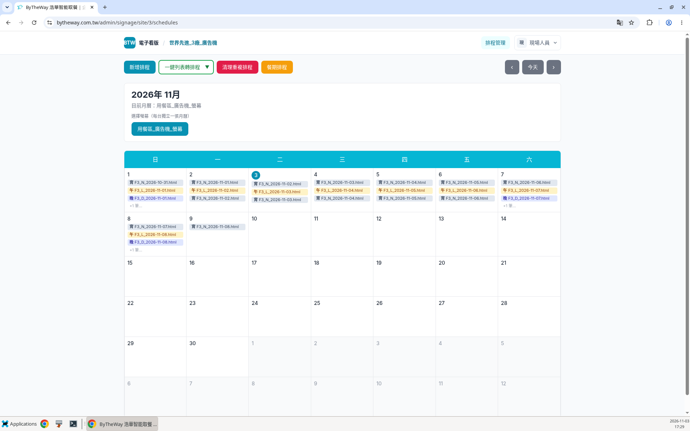
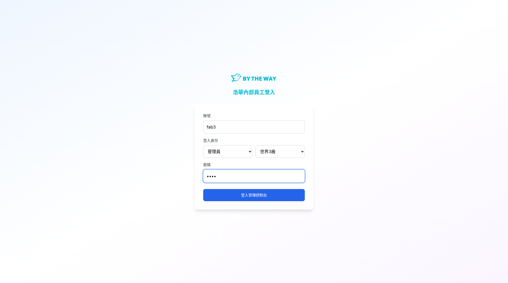
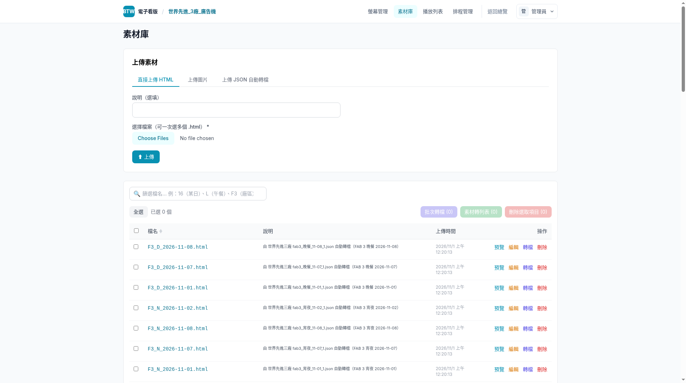
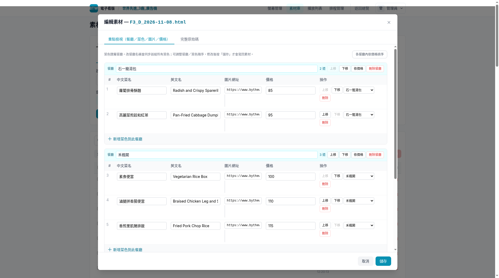

# VIS 電子看版菜單「改名改價」操作 SOP

> 適用對象：後台管理員  
> 操作範圍：世界先進三廠（Site 3）素材庫  
> 最後更新：2026-11-03（Asia/Taipei）

---

## 一、這個功能在做什麼？

當需要修改菜單上某道餐點的名稱、英文名、或價格時，管理員可在**素材庫**直接編輯，修改後會反映到該素材所排定的播放畫面。

本 SOP 適用於：

- 修改**餐點中文名稱**（例如：「蘿蔔排骨酥麵」→「蘿蔔排骨湯麵」）
- 修改**餐點英文名稱**
- 修改**餐點價格**
- 修改**餐廳分組名稱**（例如：「石一籠湯包」→「石一籠」）

> ⚠ 本功能用於**已產生的菜單素材**，適合臨時微調。若是整批更新（例如每月換新菜單），請使用 [菜單 JSON 上傳自動轉檔指南](菜單JSON上傳轉檔指南.md)。

---

## 二、權限說明：為什麼要用管理員帳號？

| 登入身份 | 可使用功能 | 不可使用功能 |
|---|---|---|
| **管理員** | 螢幕管理、素材庫、播放列表、排程管理、總覽 | — |
| **現場人員** | 排程管理（僅限所屬廠區） | 螢幕管理、**素材庫**、播放列表、總覽 |

現場人員帳號登入後，系統會自動導向排程頁面並**鎖定導覽列**，只能操作排程管理。如下圖所示，導覽列只顯示「排程管理」，無法進入素材庫：

因此，**修改菜名或價格必須使用管理員帳號登入**。

> 💡 現場人員若需要標示「售完」，請參考 [VIS 電視菜單「售完」操作 SOP](VIS_廣告機菜單售完操作SOP.md)，那是在播放畫面操作，不需要進入後台。

---

## 三、登入步驟

1. 打開瀏覽器，前往後台網址：`https://bytheway.com.tw/admin`
2. 輸入**帳號**與**密碼**
3. 在「登入身份」選擇：
   - 第一個下拉選單：**管理員**
   - 第二個下拉選單：**世界3廠**
4. 點擊「登入管理控制台」

> ⚠ 請確認選擇的是「**管理員**」而非「現場人員」，否則無法進入素材庫。

---

## 四、進入世界三廠素材庫

登入成功後，會看到電子看版總覽。請依下列步驟進入三廠素材庫：

1. 點擊左上角或總覽列表中的「**世界先進_3廠_廣告機**」
2. 進入後，點擊上方導覽列的「**素材庫**」

素材列表會顯示已上傳的菜單檔案，命名格式如：
- `F3_D_2026-11-08.html`（F3 = 三廠、D = 晚餐、日期）
- `F3_L_2026-11-08.html`（L = 午餐）
- `F3_N_2026-11-08.html`（N = 宵夜）

找到要修改的那份菜單，點擊該列右側的「**編輯**」。

---

## 五、編輯餐點名稱與價格

點擊「編輯」後，會彈出編輯視窗。請切換到「**重點編輯（餐廳/菜色/圖片/價格）**」頁籤：

### 可編輯欄位

每個餐廳區塊下會列出該餐廳的菜色，每道菜可修改：

| 欄位 | 說明 | 範例 |
|---|---|---|
| **中文菜名** | 顯示在菜單上的中文名稱 | 蘿蔔排骨酥麵 |
| **英文名** | 顯示在菜單上的英文名稱 | Radish and Crispy Spareribs |
| **價格** | 顯示在菜單上的售價 | 85 |
| **餐廳名稱** | 分組標題（點擊藍色標籤可修改） | 石一籠湯包 |

### 操作方式

1. 直接在欄位中修改文字或數字
2. 可使用「上移」「下移」調整菜色順序
3. 可點擊「+ 新增菜色到此餐廳」新增品項
4. **修改完畢後，請仔細核對再按「儲存」**
5. 若不想保存變更，按「取消」關閉視窗

> ⚠ 儲存後，修改會立即生效於該素材。若該素材已排入播放，畫面會在下次載入時更新。

---

## 六、操作時請注意

| 請這樣做 | 請不要這樣做 |
|---|---|
| 用**管理員**身份登入 | 用現場人員身份（無法進素材庫） |
| 選擇正確的**世界3廠** | 選錯廠區（會進到別廠的素材） |
| 找到**正確日期、正確時段**的菜單再編輯 | 改錯檔案（例如改到明天的、或改到午餐的） |
| 修改後**仔細核對**再儲存 | 打錯字直接儲存 |
| 一次只改需要改的項目 | 順手亂改其他欄位 |
| 改完確認播放畫面已更新 | 改完不確認就離開 |

其他說明：

- 若要大量更新（例如整月菜單），請使用 [菜單 JSON 上傳自動轉檔](菜單JSON上傳轉檔指南.md) 功能
- 售完標示請用現場手機操作，見 [售完操作 SOP](VIS_廣告機菜單售完操作SOP.md)
- 本 SOP 僅適用於世界先進三廠（Site 3），其他廠區操作方式類似但需選擇對應廠區

---

## 七、狀況排除

| 狀況 | 可能原因 | 處理方式 |
|---|---|---|
| 登入後看不到「素材庫」選項 | 用現場人員身份登入 | 登出，改用管理員身份重新登入 |
| 找不到要修改的菜單檔案 | 日期或時段選錯、尚未上傳 | 用搜尋功能篩選日期/時段，或先上傳菜單 |
| 儲存後播放畫面沒變化 | 瀏覽器或廣告機有快取 | 等待幾秒後重新整理；若仍不變，請聯絡營運 |
| 按儲存出現錯誤訊息 | 網路中斷或欄位格式錯誤 | 檢查網路連線，確認欄位沒有特殊字元 |
| 不小心改錯並儲存了 | 誤操作 | 重新進入編輯，改回正確內容並儲存 |
| 想還原到 JSON 原始資料 | 修改太多想重來 | 重新上傳該日期的 JSON，會覆蓋舊素材 |

---

## 八、給管理員的一句話

**登入管理員 + 世界3廠 → 素材庫 → 找到菜單按編輯 → 重點編輯改名改價 → 核對後儲存。現場人員進不了素材庫。**
