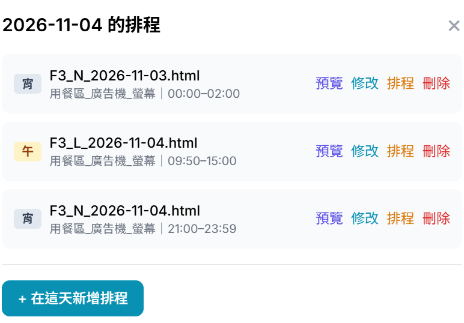

# VIS 電子看版菜單「改名改價」操作 SOP

> 適用對象：**現場人員**  
> 操作範圍：世界先進三廠（Site 3）排程管理  
> 入口網址：https://bytheway.com.tw/admin  
> 最後更新：2026-11-04（Asia/Taipei）

---

## 一、這個功能在做什麼？

當需要修改菜單上某道餐點的名稱、英文名、或價格時，現場人員可在**排程管理**裡點日期，對該餐期按「**修改**」直接調整。

本 SOP 適用於：

- 修改**餐點中文名稱**（例如：「蘿蔔排骨酥麵」→「蘿蔔排骨湯麵」）
- 修改**餐點英文名稱**
- 修改**餐點價格**
- 修改**餐廳分組名稱**（例如：「石一籠湯包」→「石一籠」）

> ⚠ **本文件給現場人員使用。請勿進入「素材庫」。**

---

## 二、登入步驟（現場人員）

1. 打開瀏覽器，前往後台網址：`https://bytheway.com.tw/admin`
2. 輸入**現場人員帳號**與**密碼**
3. 在「登入身份」選擇：
   - 第一個下拉選單：**現場人員**
   - 第二個下拉選單：**世界3廠**
4. 點擊「登入管理控制台」

> ⚠ 提醒：請確認選的是「**現場人員**」，不要選「管理員」。

---

## 三、在排程裡改菜名價錢

1. 登入後會停在「**排程管理**」（這是正常的）

2. 點擊要調整的**那一天**
3. 在當天排程清單中，找到午餐／晚餐／宵夜等**該餐期列**
4. 按藍色「**修改**」（不要按刪除；「排程」是改時段用的）

5. 在修改畫面調整菜名／價錢，**核對後儲存**；不確定請按「取消」

### 檔名格式說明

排程清單中的檔名格式如下：

| 檔名前綴 | 餐期 |
|---|---|
| F3_D_ | 晚餐 |
| F3_L_ | 午餐 |
| F3_N_ | 宵夜 |

例如：`F3_L_2026-11-04.html` 表示三廠 11 月 4 日的午餐菜單。

---

## 四、操作時請注意

| ✅ 請這樣做 | ❌ 請不要 |
|---|---|
| 登入身份選「**現場人員**」 | 為了改菜名去選「管理員」 |
| 只操作**世界3廠**排程 | 改到其他廠區 |
| 點日期 → 按「**修改**」 | 點上方「素材庫」或自己開素材庫網址 |
| 儲存前**核對**菜名、英文名、價格 | 未核對就直接儲存，或亂按刪除 |
| 不確定時按「**取消**」 | 隨意刪除排程列 |

> ⚠ **禁止進入素材庫**：現場人員不需要也不應該使用素材庫功能。改菜名價錢請一律從排程管理進入。

---

## 五、狀況排除

| 狀況 | 可能原因 | 處理方式 |
|---|---|---|
| 登入被要求改選管理員 | 帳號角色不符 | 請用現場人員帳號，並選「現場人員」身份 |
| 看不到某天的菜單列 | 當日尚未建排程或選錯日期 | 確認日期與廠區；仍無請聯絡營運 |
| 按修改後找不到欄位 | 誤按「排程」而非「修改」 | 改按藍色「修改」；仍不行請聯絡營運 |
| 儲存後看板畫面沒變 | 播放端快取尚未更新 | 稍候再確認；仍未更新請聯絡營運 |

---

## 六、一句話總結

**現場人員登入 + 世界3廠 → 排程點日期 → 該餐期按「修改」→ 改菜名價錢 → 核對後儲存。不要進素材庫。**
